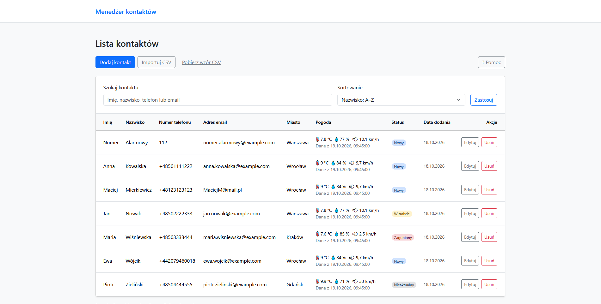
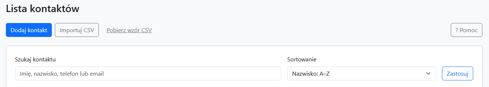
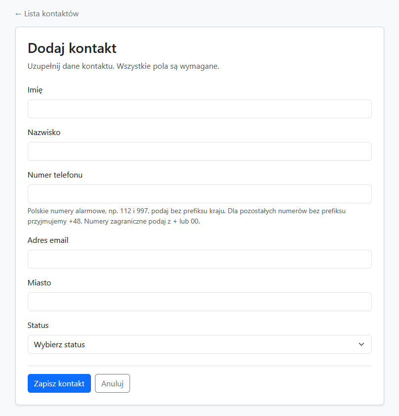
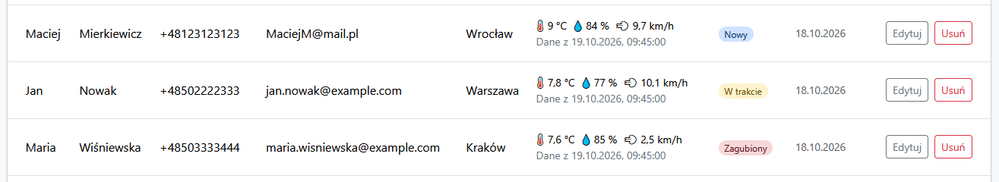
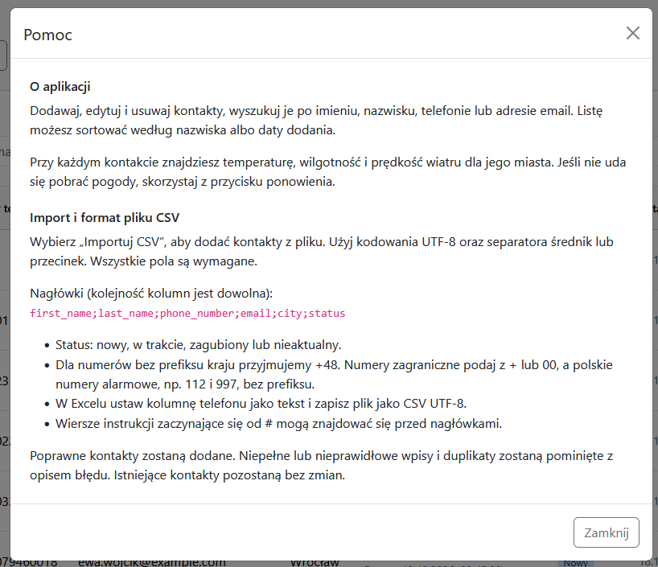

# Contact Management

**Polska wersja znajduje się poniżej:** [Wersja polska](#polska-wersja) · **[Instrukcja uruchomienia](#instrukcja-uruchomienia)**.

A Django contact manager with a web interface, a REST API, CSV import, and weather
information for each contact's city.

<a id="contents"></a>

## Contents / Spis treści

- **[Run instructions](#run-instructions)** — [Docker](#run-with-docker) · [Local Python](#run-without-docker)
- **[Instrukcja uruchomienia po polsku](#instrukcja-uruchomienia)** — [Docker](#uruchomienie-z-dockerem) · [Lokalny Python](#uruchomienie-bez-dockera)
- [Application and approach](#application-and-approach) / [Opis aplikacji i podejście](#opis-aplikacji-i-podejscie)
- [Screenshots](#screenshots) / [Zrzuty ekranu](#zrzuty-ekranu)
- [Sample CSV import](#sample-csv-import) / [Przykładowy import CSV](#przykladowy-import-csv)
- [Data and configuration](#data-and-configuration) / [Dane i konfiguracja](#dane-i-konfiguracja)
- [Tests and useful commands](#tests-and-useful-commands) / [Testy i przydatne polecenia](#testy-i-przydatne-polecenia)

## Run instructions

**The quickest way to start is Docker Compose.** Alternatively, use a local
Python 3.12 environment. Run commands from the project directory.

### Configure the environment

Both options require a `.env` file:

1. Copy `.env.example` to `.env` if the file does not exist.
2. Set `DJANGO_SECRET_KEY` in `.env` to a private random value. With Python
   installed, generate one with:

   ```sh
   python -c "import secrets; print(secrets.token_urlsafe(64))"
   ```

   Paste the result after `DJANGO_SECRET_KEY=` in `.env`.

Both startup options use port 8000, so run only one at a time.

### Run with Docker

Start Docker Desktop with Linux containers enabled. After configuring `.env`, run:

```sh
docker compose up --build
```

**Open the application: <http://localhost:8000/>.** Migrations run automatically
before the server starts, including the four initial contact statuses.

The API is available at <http://localhost:8000/api/contacts/>;
see [API documentation](contacts/api/README.md).
Stop the application with `Ctrl+C`, or run `docker compose down` in another terminal.

This setup uses Django's development server and serves the application's static
files. It is intended for local development and project review.

### Run without Docker

Install **Python 3.12** and configure `.env` as described above. On macOS and
Linux, use `python3` to create the environment if `python` is unavailable.

1. Create a virtual environment:

   ```sh
   python -m venv .venv
   ```

2. Activate it using the command for your shell.

   Windows PowerShell:

   ```powershell
   .\.venv\Scripts\Activate.ps1
   ```

   macOS / Linux:

   ```sh
   source .venv/bin/activate
   ```

3. Install the dependencies:

   ```sh
   python -m pip install -r requirements.txt
   ```

4. Create the database tables and initial contact statuses:

   ```sh
   python manage.py migrate
   ```

5. Start the server:

   ```sh
   python manage.py runserver
   ```

**Open the application: <http://localhost:8000/>.** The API is available at
<http://localhost:8000/api/contacts/>; see [API documentation](contacts/api/README.md).
Stop the server with `Ctrl+C`.

## Application and approach

The application supports adding, editing, and deleting contacts, searching by
first name, last name, phone number, or email, and sorting by last name or creation
date. Each contact has a status stored in a separate database table.

CSV import validates individual rows, adds valid contacts, and reports invalid
entries and duplicates. Phone numbers are normalized consistently across forms,
CSV import, and the API; phone numbers and email addresses must be unique.
The public JSON API supports listing, creating, updating, and deleting contacts.

The implementation keeps the project simple: Django templates render the pages,
Bootstrap provides the responsive layout and components, and small JavaScript
files handle form feedback, CSV upload, and weather loading. There is no separate
frontend build step.

Additional features:

- **Weather and cache:** city coordinates come from OpenStreetMap Nominatim;
  Open-Meteo provides temperature, humidity, and wind speed. Weather results are
  cached for 30 minutes to reduce requests. Previously fetched data can be shown
  with a warning when a provider is unavailable, with a retry option in the UI.
- **Docker Compose:** one command builds and starts the application, runs
  migrations, and keeps the database and weather cache in a persistent volume.
- **Three unit tests:** cover phone normalization, Polish emergency short codes,
  and respecting a weather provider's `Retry-After` response.

## Screenshots

The main view combines contact details, city weather, status badges, and row actions.



<details>
<summary>More screenshots: search, contact form, row actions, and help</summary>

**Search and sorting.** The toolbar provides contact creation, CSV import, a
downloadable CSV template, and help. Search and sorting sit directly above the list.



**Adding a contact.** A focused form contains all required fields and guidance on
phone number formats.



**Editing and deleting.** Actions are available in each contact row, alongside its
status and weather information.



**Help.** The help dialog explains the application and CSV format without taking
space away from the contact list.



</details>

## Sample CSV import

[examples/contacts.csv](examples/contacts.csv) contains six fictional sample
contacts, including all four statuses, several phone formats, and a Polish
emergency number. The file uses UTF-8 with BOM and a semicolon separator.

On the contact list page, click **Importuj CSV** and select this file. All six
records can be imported into an empty database. Existing contacts with matching
phone numbers or email addresses are reported as duplicates and skipped.

A CSV template can also be downloaded from the list page. The **Pomoc** dialog
describes the required columns, accepted values, and import behavior.

## Data and configuration

Compose passes `.env` values into the container. The file is excluded from the
image, along with the local virtual environment, database, and weather cache.

SQLite and weather cache files are stored in the `contact_data` volume, mounted
at `/app/data`. Docker starts with a separate, empty database; the existing local
`db.sqlite3` is not imported automatically. Data survives container recreation and
`docker compose down`. Adding `--volumes` to that command deletes the stored data.

`DJANGO_DATA_DIR` selects the storage directory. Compose sets it to `/app/data`.
Without this setting, running locally stores the database in `db.sqlite3` and
weather cache files in `.cache/` in the project directory.

After changing application code or dependencies, rebuild with
`docker compose up --build`.

## Tests and useful commands

With the application running in Docker:

```sh
# Run the three unit tests
docker compose exec web python manage.py test contacts

# Create an administrator
docker compose exec web python manage.py createsuperuser
```

Without Docker, with the virtual environment activated:

```sh
python manage.py test contacts
python manage.py createsuperuser
```

The administrator can sign in at <http://localhost:8000/admin/>.

Stop and remove the Docker containers while keeping stored data:

```sh
docker compose down
```

---

<a id="polska-wersja"></a>

## Wersja polska

Aplikacja do zarządzania kontaktami stworzona w Django. Umożliwia wygodne zarządzanie kontaktami przez przeglądarkę, udostępnia REST API, obsługuje import danych z plików CSV oraz wyświetla aktualne informacje pogodowe dla miast przypisanych do kontaktów.

**[Przejdź do instrukcji uruchomienia](#instrukcja-uruchomienia)** · [Spis treści](#contents)

<a id="instrukcja-uruchomienia"></a>

## Instrukcja uruchomienia

Najprostszym sposobem uruchomienia aplikacji jest skorzystanie z **Docker Compose**. Możliwe jest również uruchomienie projektu lokalnie przy użyciu Pythona 3.12, bez Dockera.

Wszystkie poniższe polecenia należy wykonywać w głównym katalogu projektu.

### Konfiguracja środowiska

Niezależnie od wybranego sposobu uruchomienia należy przygotować plik `.env`:

1. Skopiuj plik `.env.example` i zapisz kopię pod nazwą `.env`.
2. W pliku `.env` ustaw zmienną `DJANGO_SECRET_KEY`, podając własny, losowo wygenerowany klucz. Możesz go wygenerować za pomocą Pythona:

   ```sh
   python -c "import secrets; print(secrets.token_urlsafe(64))"
   ```

   Otrzymany klucz wklej jako wartość `DJANGO_SECRET_KEY` w pliku `.env`.

**Uwaga:** Oba sposoby uruchomienia wykorzystują port 8000, dlatego nie należy uruchamiać ich jednocześnie.

### Uruchomienie z Dockerem

Uruchom Docker Desktop i upewnij się, że pracuje w trybie kontenerów Linux.

Po przygotowaniu pliku `.env` wykonaj:

```sh
docker compose up --build
```

Po uruchomieniu aplikacja będzie dostępna pod adresem:

**http://localhost:8000/**

Podczas startu kontenera automatycznie wykonywane są migracje bazy danych, które tworzą również cztery domyślne statusy kontaktów. Nie trzeba wykonywać żadnych dodatkowych poleceń.

REST API jest dostępne pod adresem http://localhost:8000/api/contacts/. Szczegółowy opis endpointów znajduje się w [dokumentacji API (w języku angielskim)](contacts/api/README.md).

Aby zatrzymać aplikację, naciśnij `Ctrl+C` w terminalu lub wykonaj w osobnym terminalu:

```sh
docker compose down
```

### Uruchomienie bez Dockera

Do lokalnego uruchomienia aplikacji wymagany jest **Python 3.12** oraz przygotowany wcześniej plik `.env`.

Na macOS i Linuxie można użyć polecenia `python3` zamiast `python`, jeśli jest ono wymagane przez konfigurację systemu.

1. **Utwórz środowisko wirtualne:**

   ```sh
   python -m venv .venv
   ```

2. **Aktywuj środowisko wirtualne:**

   Windows PowerShell:

   ```powershell
   .\.venv\Scripts\Activate.ps1
   ```

   macOS / Linux:

   ```sh
   source .venv/bin/activate
   ```

3. **Zainstaluj wymagane biblioteki:**

   ```sh
   python -m pip install -r requirements.txt
   ```

4. **Wykonaj migracje bazy danych:**

   ```sh
   python manage.py migrate
   ```

   Polecenie przygotuje strukturę bazy danych i utworzy cztery domyślne statusy kontaktów.

5. **Uruchom serwer Django:**

   ```sh
   python manage.py runserver
   ```

Aplikacja będzie dostępna pod adresem **http://localhost:8000/**.

REST API znajdziesz pod adresem http://localhost:8000/api/contacts/, a jego opis w [dokumentacji API](contacts/api/README.md).

Aby zatrzymać serwer, naciśnij `Ctrl+C` w terminalu.

<a id="opis-aplikacji-i-podejscie"></a>

## Opis aplikacji i przyjęte rozwiązania

Aplikacja umożliwia dodawanie, edytowanie i usuwanie kontaktów. Dostępne jest również wyszukiwanie po imieniu, nazwisku, numerze telefonu i adresie e-mail oraz sortowanie kontaktów według nazwiska lub daty dodania.

Każdemu kontaktowi można przypisać status, przy czym dostępne statusy są przechowywane w osobnej tabeli bazy danych.

**Import CSV** pozwala dodawać wiele kontaktów jednocześnie. Każdy wiersz pliku jest sprawdzany osobno, dzięki czemu poprawne rekordy mogą zostać zaimportowane nawet wtedy, gdy pozostałe zawierają błędy. Po zakończeniu importu użytkownik otrzymuje podsumowanie z informacją o dodanych kontaktach, błędach i pominiętych duplikatach.

Numery telefonów są normalizowane w taki sam sposób niezależnie od tego, czy kontakt dodano przez formularz, plik CSV czy REST API. Aplikacja wymaga również, aby numery telefonów i adresy e-mail były unikalne.

**REST API** umożliwia pobieranie, dodawanie, aktualizowanie i usuwanie kontaktów za pomocą żądań HTTP.

### Architektura aplikacji

Projekt opiera się na architekturze monolitycznej Django, z renderowaniem stron po stronie serwera (*server-side rendering*).

Interfejs został zbudowany z wykorzystaniem szablonów Django oraz Bootstrapa, który zapewnia responsywny układ i gotowe komponenty. JavaScript odpowiada za wybrane funkcje interaktywne, takie jak komunikaty walidacyjne, obsługa importu CSV i pobieranie danych pogodowych.

Takie rozwiązanie pozwala zachować prostą strukturę projektu bez konieczności uruchamiania osobnej aplikacji frontendowej ani dodatkowego procesu budowania interfejsu.

### Dodatkowe funkcjonalności

- **Pogoda i pamięć podręczna:** Aplikacja korzysta z OpenStreetMap Nominatim do wyszukiwania współrzędnych miast oraz z Open-Meteo do pobierania temperatury, wilgotności i prędkości wiatru. Dane pogodowe są przechowywane w pamięci podręcznej przez 30 minut, co ogranicza liczbę zapytań do zewnętrznych usług. Jeśli dostawca pogody jest niedostępny, aplikacja może wyświetlić ostatnio zapisane dane wraz z odpowiednim ostrzeżeniem. Użytkownik ma również możliwość ponowienia próby pobrania pogody.

- **Docker Compose:** Pozwala zbudować i uruchomić aplikację jednym poleceniem. Migracje bazy danych wykonywane są automatycznie, a baza SQLite i pamięć podręczna pogody znajdują się w trwałym wolumenie, dzięki czemu dane nie znikają po ponownym uruchomieniu kontenerów.

- **Testy jednostkowe:** Projekt zawiera trzy testy sprawdzające normalizację numerów telefonów, obsługę polskich numerów alarmowych oraz prawidłowe uwzględnianie nagłówka `Retry-After` w odpowiedziach dostawcy pogody.

<a id="zrzuty-ekranu"></a>

## Zrzuty ekranu

### Widok główny

Główny widok aplikacji przedstawia listę kontaktów wraz z ich statusami, informacjami pogodowymi oraz przyciskami umożliwiającymi edycję i usuwanie poszczególnych wpisów.


<details>
<summary>Pokaż pozostałe zrzuty ekranu</summary>

### Wyszukiwanie i sortowanie

Pasek narzędzi umożliwia dodawanie kontaktów, import plików CSV, pobieranie przykładowego pliku oraz wyświetlanie pomocy. Nad listą kontaktów znajdują się również wyszukiwarka i opcje sortowania.


### Dodawanie kontaktu

Formularz pozwala wprowadzić dane nowego kontaktu, wybrać jego status oraz zawiera wskazówki dotyczące poprawnego formatu numeru telefonu.


### Edycja i usuwanie kontaktów

Każdy kontakt ma przypisane przyciski umożliwiające edycję danych lub usunięcie wpisu.


### Pomoc

Wbudowane okno pomocy zawiera opis podstawowych funkcji aplikacji oraz instrukcję przygotowania i importowania plików CSV.


</details>

<a id="przykladowy-import-csv"></a>

## Przykładowy import CSV

W repozytorium znajduje się przykładowy plik [examples/contacts.csv](examples/contacts.csv), który można wykorzystać do przetestowania importu danych.

Plik zawiera sześć fikcyjnych kontaktów, obejmujących wszystkie cztery dostępne statusy, różne formaty numerów telefonów oraz polski numer alarmowy.

Dane zapisano w formacie UTF-8 z BOM, a separatorem kolumn jest średnik (`;`).

Aby przetestować import:

1. Uruchom aplikację i przejdź do listy kontaktów.
2. Kliknij przycisk **Importuj CSV**.
3. Wybierz plik `examples/contacts.csv`.
4. Zatwierdź import i sprawdź wyświetlone podsumowanie.

Jeśli baza danych jest pusta, wszystkie sześć kontaktów powinno zostać poprawnie zaimportowanych.

W przypadku ponownego importu kontakty z numerami telefonów lub adresami e-mail, które już istnieją w bazie, zostaną rozpoznane jako duplikaty i pominięte.

Przykładowy plik CSV można również pobrać bezpośrednio z interfejsu aplikacji. Szczegółowe informacje o wymaganych kolumnach i dopuszczalnych wartościach znajdują się w oknie **Pomoc**.

<a id="dane-i-konfiguracja"></a>

## Przechowywanie danych i konfiguracja

W przypadku uruchomienia przez Docker Compose zmienne środowiskowe są pobierane z pliku `.env` i przekazywane do kontenera.

Ze względów bezpieczeństwa plik `.env` nie jest dołączany do obrazu Dockera. Podczas budowania pomijane są również lokalne środowisko wirtualne, baza danych oraz pliki pamięci podręcznej pogody.

### Przechowywanie danych w Dockerze

Baza danych SQLite oraz pamięć podręczna pogody są zapisywane w wolumenie `contact_data`, zamontowanym w kontenerze pod ścieżką `/app/data`.

Docker korzysta z osobnej bazy danych, dlatego kontakty zapisane wcześniej w lokalnym pliku `db.sqlite3` nie zostaną automatycznie przeniesione do kontenera.

Dane pozostają zachowane po ponownym uruchomieniu lub odtworzeniu kontenerów, również po wykonaniu:

```sh
docker compose down
```

**Uwaga:** Użycie polecenia `docker compose down --volumes` usuwa także wolumen z zapisanymi danymi aplikacji.

### Przechowywanie danych bez Dockera

Za lokalizację danych odpowiada zmienna środowiskowa `DJANGO_DATA_DIR`.

W konfiguracji Docker Compose jest ona ustawiona na `/app/data`.

Podczas uruchamiania aplikacji lokalnie, jeśli zmienna nie została ustawiona:

- Baza SQLite jest zapisywana w pliku `db.sqlite3` w katalogu projektu.
- Pamięć podręczna pogody znajduje się w katalogu `.cache/`.

### Aktualizacja aplikacji

Po zmianie kodu źródłowego lub zależności aplikacji uruchom ponownie budowanie obrazu:

```sh
docker compose up --build
```

<a id="testy-i-przydatne-polecenia"></a>

## Testy i przydatne polecenia

### Uruchamianie testów

Projekt zawiera trzy testy jednostkowe, które można uruchomić z poziomu terminala.

**W Dockerze**, gdy kontener aplikacji jest uruchomiony:

```sh
docker compose exec web python manage.py test contacts
```

**Lokalnie**, po aktywowaniu środowiska wirtualnego:

```sh
python manage.py test contacts
```

### Tworzenie konta administratora

Aby uzyskać dostęp do panelu administracyjnego Django, należy utworzyć konto administratora.

**W Dockerze:**

```sh
docker compose exec web python manage.py createsuperuser
```

**Lokalnie:**

```sh
python manage.py createsuperuser
```

Po utworzeniu konta panel administracyjny będzie dostępny pod adresem:

**http://localhost:8000/admin/**

### Zatrzymywanie aplikacji

Aby zatrzymać i usunąć kontenery Dockera bez utraty zapisanych danych, wykonaj:

```sh
docker compose down
```